<div align="center">

<sub>[ PORTFOLIO ](https://kartikeya-portfolio-rx7w.vercel.app/) &nbsp;·&nbsp; [ KOVIDAM ](https://kovidam.co.in/) &nbsp;·&nbsp; [ LINKEDIN ](https://www.linkedin.com/in/kartikeya2006/) &nbsp;·&nbsp; [ GITHUB ](https://github.com/kartikeyajay2006)</sub>


<br>


<sub>Live from the GitHub API — regenerated by GitHub Actions on every push and roughly every 3 hours. Not a static number.</sub>

<br>


<sub>Commit City — the real 12-month contribution calendar as a skyline: every building is one day, and its height is that day's contributions. Rebuilt from the GitHub API on every push and every 3 hours.</sub>

</div>

<br>

<div align="center">

[`02` IDENTITY](#02-identity) &nbsp;·&nbsp; [`03` KOVIDAM](#03-building-kovidam) &nbsp;·&nbsp; [`04` SELECTED WORK](#04-selected-work) &nbsp;·&nbsp; [`05` SYSTEMS](#05-systems) &nbsp;·&nbsp; [`06` ATLAS](#06-engineering-atlas)<br>
[`07` RHYTHM](#07-build-rhythm) &nbsp;·&nbsp; [`08` STACK](#08-stack-dna) &nbsp;·&nbsp; [`09` JOURNEY](#09-engineering-journey) &nbsp;·&nbsp; [`10` HONORS](#10-credentials--honors) &nbsp;·&nbsp; [`11` CONTACT](#11-contact)

</div>

<table>
<tr>
<td width="33%" valign="top">

<sub>NOW // BUILDING</sub><br>
**Co-Founder &amp; AI Engineer**<br>
[Kovidam](https://kovidam.co.in/) — AI talent intelligence

</td>
<td width="33%" valign="top">

<sub>NOW // LEADING</sub><br>
**Product &amp; Applied AI Lead**<br>
AI-ML Club

</td>
<td width="33%" valign="top">

<sub>LATEST // WIN</sub><br>
**Gradient Rush Hackathon — Winner**<br>
September 2026

</td>
</tr>
</table>

<br>

## 02 Identity


<sub>Every planet is one of my public repos, born in the order I started them: its orbit is when it began, its size is its code. Rebuilt from the GitHub API every 6 hours, so each new repo appears on the outer ring.</sub>

<br>

## 03 Building Kovidam

<table>
<tr>
<td width="220" align="center">

### KOVIDAM
**AI Talent Intelligence Platform**
<sub>Co-Founder &amp; AI Engineer</sub>

[kovidam.co.in →](https://kovidam.co.in/)

</td>
<td>

```
KOVIDAM
├── SKILL GRAPH   →  who to interview   →  Kovidam-Skill-Graph
└── AI INTERVIEW  →  how they think     →  kovidam-AI-Interview
```

**[`Kovidam Skill Graph`](https://github.com/kartikeyajay2006/Kovidam-Skill-Graph)** — hire on engineering evidence, not keywords. Parses a stack of resumes, pulls each candidate's real work from GitHub and five coding platforms in parallel, and returns a ranked shortlist in which every score explains itself: relevance, evidence and authenticity gates, then a confidence level.
     

**[`Kovidam AI Interview`](https://github.com/kartikeyajay2006/kovidam-AI-Interview)** — first-round technical interviews that run themselves. An AI interviewer grounded in each candidate's own resume works through a competency ladder, and the recruiter reviews a compact packet (Q&amp;A map, playback, state trace) in minutes instead of sitting through the call.
     

</td>
</tr>
</table>

<br>

## 04 Selected Work


<p align="center">
<a href="https://github.com/kartikeyajay2006/Sovereign-On_Premise-Agentic-AI-Workbench"></a>
<a href="https://github.com/kartikeyajay2006/jky-terminal"></a>
</p>
<p align="center">
<a href="https://github.com/kartikeyajay2006/JKY-Radar"></a>
<a href="https://github.com/kartikeyajay2006/Agent_that_act-Hackathon"></a>
</p>
<p align="center">
<a href="https://github.com/kartikeyajay2006/Wispr_goa_task"></a>
<a href="https://github.com/kartikeyajay2006/Multimodal-Data-Management-Pipeline-for-RAG-Ready-Systems"></a>
</p>
<p align="center">
<a href="https://github.com/kartikeyajay2006/multi-layer_orchestation"></a>
<a href="#05-systems"></a>
</p>

<p align="center"><sub>Each sheet is the how-it-works flow from that project's own README, with its code size, commits and languages from the GitHub API. LIVE is the health check GitHub Actions runs every 3 hours.</sub></p>

<p align="center"><b>Live</b> &nbsp;·&nbsp; <a href="https://kartikeyajay2006.github.io/jky-terminal/">JKY Terminal</a> &nbsp;·&nbsp; <a href="https://jky-radar.onrender.com">JKY-Radar</a> <sub>(free tier, ~30 s to wake)</sub> &nbsp;·&nbsp; <a href="https://frontend-sigma-murex-82.vercel.app/">Evidence Console</a> &nbsp;·&nbsp; <a href="https://multi-layer-orchestation.vercel.app/">Chakraview</a></p>

<details>
<summary><strong>Architecture notes</strong> — how each one works, and how it proves it</summary>
<br>

**AEGIS** — Figures come from 21 versioned, clause-cited formulas, never from the model; every material sentence is traced to the passage or calculation it cites, and a claim nothing supports fails verification. When two records disagree, no figure is stated until a named person chooses. A High finding needs two signatures, Head of Inspection and then Plant Manager. Models run through Ollama on loopback, generated code runs in a sandbox the kernel cuts off from the network, and every step lands in a SHA-256 hash chain with Ed25519-signed roots and a per-run certificate anyone can verify offline. 31 of 31 attacks held against a live host; 1,211 tests. [Source](https://github.com/kartikeyajay2006/Sovereign-On_Premise-Agentic-AI-Workbench)

**JKY Terminal** — A background supervisor keeps long-running jobs alive across window closes, and rejoining a pane restores what it printed meanwhile. Eight deterministic parsers turn `git`, `docker`, `ps`, `df`, `ls` and JSON output into panels beneath the raw text, with no model in that path. *The window asks, only Rust acts*: twenty-two crates own PTYs, files, keys, history and the audit log, secrets are redacted in Rust before they reach history or an AI provider, and all 123 IPC commands are pinned by name in a test. The assistant must ask before every command. 2,324 frontend and 1,315 Rust tests. [Source](https://github.com/kartikeyajay2006/jky-terminal) · [Site](https://kartikeyajay2006.github.io/jky-terminal/)

**JKY-Radar** — One deterministic pipeline (parse safely → normalise → match → classify → gate) runs in the browser, on the server and in an offline CLI, so identical inputs always produce identical findings. 157 versioned, direction-aware rules: a new required field breaks *requests* but is additive in *responses*. Seven contract formats, each stating its real support level. The gate returns pass, warn, block or *inconclusive*, never "safe" when coverage is incomplete. 535 unit and 23 end-to-end tests. [Source](https://github.com/kartikeyajay2006/JKY-Radar) · [Live](https://jky-radar.onrender.com)

**ForgeSRE** — Built for the TrueFoundry × Polaris *Agents That Act* hackathon. Every tool is risk-classed: reads run freely, a service restart runs on its own inside an allowlist and a rate limit, and a production rollback pauses at TrueForge's approval gate; shell, raw SQL and deletes are never exposed. After a human clicks *Allow*, the server re-checks the session record for that exact call before it switches traffic, then `verify_recovery` measures readiness, synthetic checkouts, error rate, p95 and database load against thresholds. 17 MCP tools; 63 unit, 12 integration and 4 TrueForge tests. [Source](https://github.com/kartikeyajay2006/Agent_that_act-Hackathon)

**EraseOps** — Ask in plain words or out loud, and a LangGraph team of agents finds a customer's records across PostgreSQL and object storage. The agents only investigate: destructive MCP tools are never declared to the model. The rehearsal is a real PostgreSQL transaction that is always rolled back, approval is single-use and expires, every step lands in a tamper-evident hash chain, and a zero-residual rescan seals a certificate of erasure. [Source](https://github.com/kartikeyajay2006/Wispr_goa_task)

**Multimodal Evidence Console** — Each modality stays a first-class, timestamped, page-numbered observation (Whisper speech, OCR, vision captions, scene detection, speaker diarization), cross-linked to the others instead of flattened into text chunks. PostgreSQL with pgvector holds the evidence, Neo4j the typed relationships the retriever traverses, and the repo evaluates the graph against a flat-text RAG baseline. 90+ backend and 35+ frontend tests. [Source](https://github.com/kartikeyajay2006/Multimodal-Data-Management-Pipeline-for-RAG-Ready-Systems) · [Live](https://frontend-sigma-murex-82.vercel.app/)

**Chakraview** — Three layers. Orchestration: a task runs through planner, execution and review nodes, and workflows chain steps in parallel. Observability: every node records its input, output and token use, streamed over WebSockets. Control: each result gets a confidence score, and below the threshold (0.7 by default) the task stops at `waiting_for_approval`. Multi-tenant workspaces with roles from owner to viewer. [Source](https://github.com/kartikeyajay2006/multi-layer_orchestation) · [Live](https://multi-layer-orchestation.vercel.app/)

</details>

<br>

## 05 Systems


<p align="center">
<a href="https://github.com/kartikeyajay2006/JKY-Folder"></a>
<a href="https://github.com/kartikeyajay2006/my-localmcp"></a>
</p>
<p align="center">
<a href="https://github.com/kartikeyajay2006/github-ranking"></a>
<a href="https://github.com/kartikeyajay2006/agent--flow"></a>
</p>
<p align="center">
<a href="https://github.com/kartikeyajay2006/Multimodel-governance-B2A">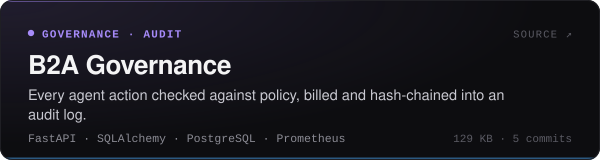</a>
<a href="https://github.com/kartikeyajay2006/RL-model-Negotiation"></a>
</p>
<p align="center">
<a href="https://github.com/kartikeyajay2006/GitVeda"></a>
<a href="https://github.com/kartikeyajay2006/AI-Businesses"></a>
</p>
<p align="center">
<a href="https://github.com/kartikeyajay2006/AI-Video-Editor"></a>
<a href="https://github.com/kartikeyajay2006/Financial-Health-Score"></a>
</p>
<p align="center">
<a href="https://github.com/kartikeyajay2006/Cardano-BlockPhantom"></a>
<a href="https://github.com/kartikeyajay2006/2nd-Year-MERN-P_S"></a>
</p>
<p align="center">
<a href="https://github.com/kartikeyajay2006/codecrafters-shell-java"></a>
<a href="https://github.com/kartikeyajay2006/ai-image-classifier"></a>
</p>
<p align="center">
<a href="https://github.com/kartikeyajay2006/Agentra-Website"></a>
<a href="https://github.com/kartikeyajay2006/blood-group-donor"></a>
</p>
<p align="center">
<a href="https://github.com/kartikeyajay2006/project_ideas--AI-ML-CLUB"></a>
<a href="https://github.com/kartikeyajay2006/kartikeya-portfolio"></a>
</p>

<p align="center"><b>Live</b> &nbsp;·&nbsp; <a href="https://git-veda-phi.vercel.app">GitVeda</a> &nbsp;·&nbsp; <a href="https://shopkart-black-one.vercel.app">ShopKart</a> &nbsp;·&nbsp; <a href="https://agentra-website-chi.vercel.app">Agentra</a> &nbsp;·&nbsp; <a href="https://blood-group-donor-two.vercel.app">BloodConnect</a> &nbsp;·&nbsp; <a href="https://projectideas-ai-ml.vercel.app">AI-ML Club Ideas</a> &nbsp;·&nbsp; <a href="https://kartikeya-portfolio-rx7w.vercel.app/">Portfolio</a></p>

<details>
<summary><strong>Fine print</strong> — what each prototype does and does not do</summary>
<br>

- **AgentFlow OS** — LOW and MEDIUM risk actions run on their own, HIGH needs one approval and CRITICAL two. The external connectors (Salesforce, Stripe, Workday, Jira) are documented in the repo as mocked; the governance layer is the point.
- **B2A Governance** — a per-tenant policy engine returns allow, deny or review; each audit event stores the SHA-256 of the one before it, and billing is a double-entry style ledger in exact `Decimal` arithmetic.
- **Financial Health Card** — a hackathon prototype: the models train on synthetic profiles and the data fetch is simulated.
- **BlockPhantom** — Cardano Hackathon Asia finalist; the scoring still runs in demo mode.
- **BloodConnect** — a responsive React app on a sample donor API.
- **github-ranking** — the live instance ranks real applicants, so it stays private; the code is public.
- **DealForge** — the LLM buyer (Qwen2.5-0.5B-Instruct) is fine-tuned with TRL PPO on a free Colab GPU; the reward splits each step into five components, including fairness.

</details>

<details>
<summary><strong>Other work</strong> — coursework, challenges and smaller experiments</summary>
<br>

- [`Linux-Lab-Assignment-BITS`](https://github.com/kartikeyajay2006/Linux-Lab-Assignment-BITS) — systems programming lab: a backup script with MD5 duplicate detection, a C process monitor with zombie prevention, system-call file I/O and a real-time log pipeline
- [`bits-cli-assignment`](https://github.com/kartikeyajay2006/bits-cli-assignment) — five hands-on Linux investigations into identity, permissions, links, file descriptors and storage
- [`Reinforce_Club-SST`](https://github.com/kartikeyajay2006/Reinforce_Club-SST) — MNIST in 2D: 60,000 digits compressed from 784 dimensions to 2 with PCA and t-SNE until the ten classes separate
- [`Math-EDA`](https://github.com/kartikeyajay2006/Math-EDA) — Aerofit treadmill EDA: 180 buyers profiled by model, turned into a targeting strategy
- [`Full-Agentic-AI-basics-to-advance-`](https://github.com/kartikeyajay2006/Full-Agentic-AI-basics-to-advance-) — runnable LangChain examples, one concept per folder: LLM calls, memory, prompts, embeddings, structured output
- [`Weather-App`](https://github.com/kartikeyajay2006/Weather-App) — WeatherNexus: real-time conditions, hourly and 5-day forecasts, UV and air quality, GPS location, five themes
- [`Student-Dost`](https://github.com/kartikeyajay2006/Student-Dost) — tasks, income and expenses, and habit streaks for students · [live](https://student-dost.vercel.app)
- [`Soundboard`](https://github.com/kartikeyajay2006/Soundboard) — a first web-audio project · [live](https://soundboard-six-phi.vercel.app)
- [`Scaler-1st-Year-Assignments`](https://github.com/kartikeyajay2006/Scaler-1st-Year-Assignments) — 12 hand-written HTML and CSS pages: semantic markup, forms, CSS Grid, pure-CSS shapes, keyframes
- [`Scaler-OSC-Projects`](https://github.com/kartikeyajay2006/Scaler-OSC-Projects) — a number-guessing CLI game with difficulty levels and input validation
- [`Portfolio`](https://github.com/kartikeyajay2006/Portfolio) — my first website, hand-written HTML and CSS

</details>

<br>

## 06 Engineering Atlas


<br>

## 07 Build Rhythm


<sub>When the code actually ships: every commit I've authored on the default branch of every public repo, bucketed by hour and weekday in IST and recomputed from the GitHub API every 6 hours. A moon, which becomes the sun at dawn, crosses the clock once every 24 seconds (one second per hour), lighting each hour's rod and its column in the week grid as it passes. The chronotype is derived from the data, not self-declared.</sub>

<br>

## 08 Stack DNA


<p align="center"><sub>Read from every public repo's own package.json, requirements, pyproject, Cargo, compose files, Dockerfiles, workflows and committed <code>.env.example</code>, rescanned daily by GitHub Actions. A tool no public repo uses is not on it.</sub><br>
<a href="STACK.md"><b>Where each tool is used →</b></a></p>

<br>

## 09 Engineering Journey

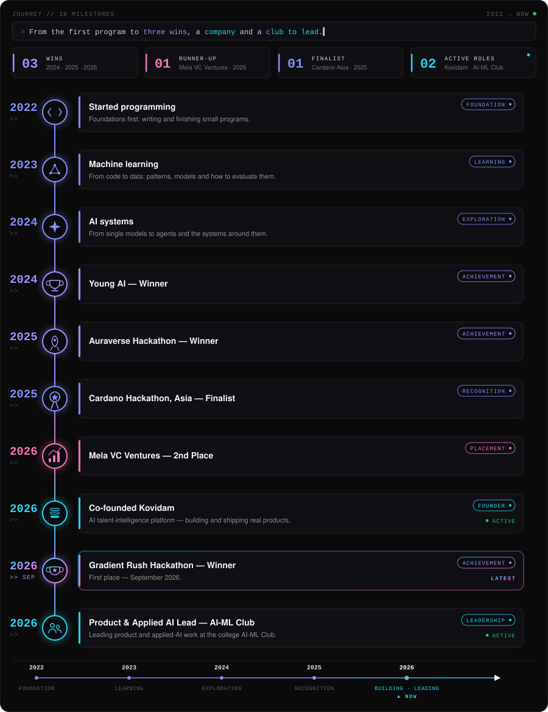

<br>

## 10 Credentials & Honors

**Education**
B.Tech, Computer Science &amp; Engineering — BITS Pilani

**Leadership**<br>
Product &amp; Applied AI Lead — AI-ML Club<br>
Co-Founder &amp; AI Engineer — [Kovidam](https://kovidam.co.in/)

**Honors**

| When | Competition | Result |
|:--|:--|:--|
| Sep 2026 | Gradient Rush Hackathon | **Winner** |
| 2026 | Mela VC Ventures | **2nd Place** |
| 2025 | Auraverse Hackathon | **Winner** |
| 2025 | Cardano Hackathon, Asia | **Finalist** |
| 2024 | Young AI | **Winner** |

**Certifications**
 

<br>

## 11 Contact

<div align="center">


<br>

<a href="https://github.com/kartikeyajay2006"></a>
<a href="https://kartikeya-portfolio-rx7w.vercel.app/"></a>
<a href="https://www.linkedin.com/in/kartikeya2006/"></a>
<a href="https://kovidam.co.in/"></a>
<a href="mailto:kartikeya2006jay@gmail.com"></a>

</div>
