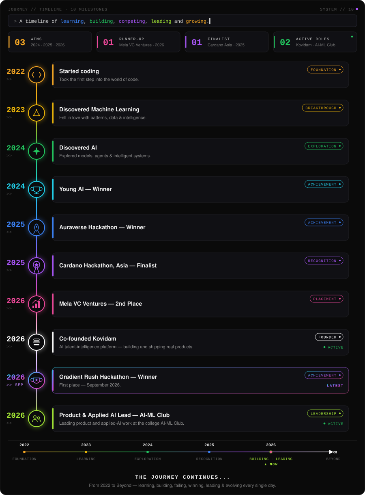

<div align="center">

<sub>[ PORTFOLIO ](https://kartikeya-portfolio-rx7w.vercel.app/) &nbsp;·&nbsp; [ KOVIDAM ](https://kovidam.co.in/) &nbsp;·&nbsp; [ LINKEDIN ](https://www.linkedin.com/in/kartikeya2006/) &nbsp;·&nbsp; [ GITHUB ](https://github.com/kartikeyajay2006)</sub>



<br>



<sub>Live from the GitHub API — regenerated by GitHub Actions on every push and roughly every 3 hours. Not a static number.</sub>

<br>



<sub>Commit City — the real 12-month contribution calendar as a skyline: every building is one day, and its height is that day's contributions. Rebuilt from the GitHub API on every push and every 3 hours.</sub>

</div>

<br>

<div align="center">

[`02` IDENTITY](#02-identity) &nbsp;·&nbsp; [`03` SYSTEMS](#03-systems-i-build) &nbsp;·&nbsp; [`04` ATLAS](#04-engineering-atlas) &nbsp;·&nbsp; [`05` KOVIDAM](#05-building-kovidam) &nbsp;·&nbsp; [`06` FLAGSHIP](#06-flagship-systems) &nbsp;·&nbsp; [`07` PROJECTS](#07-selected-projects)<br>
[`08` RHYTHM](#08-build-rhythm) &nbsp;·&nbsp; [`09` STACK](#09-stack-dna) &nbsp;·&nbsp; [`10` JOURNEY](#10-engineering-journey) &nbsp;·&nbsp; [`11` HONORS](#11-credentials--honors) &nbsp;·&nbsp; [`12` CONTACT](#12-contact)

</div>

<table>
<tr>
<td width="33%" valign="top">

<sub>NOW // BUILDING</sub><br>
**Co-Founder &amp; AI Engineer**<br>
[Kovidam](https://kovidam.co.in/) — AI talent intelligence

</td>
<td width="33%" valign="top">

<sub>NOW // LEADING</sub><br>
**Product &amp; Applied AI Lead**<br>
AI-ML Club

</td>
<td width="33%" valign="top">

<sub>LATEST // WIN</sub><br>
**Gradient Rush Hackathon — Winner**<br>
September 2026

</td>
</tr>
</table>

<br>

## 02 Identity

<sub>SYSTEM // 02</sub>


<sub>Every planet is one of my public repos, born in the order I started them: its orbit is when it began, its size is its code. Rebuilt from the GitHub API every 6 hours, so each new repo appears on the outer ring.</sub>

<br>

## 03 Systems I Build

<sub>SYSTEM // 03</sub>

<table>
<tr><td>

**◆ 01 · Intelligent Systems**
Explainable scoring, evidence-grounded retrieval, and AI that shows where every answer came from.
[`Kovidam Skill Graph`](https://github.com/kartikeyajay2006/Kovidam-Skill-Graph) · [`Kovidam AI Interview`](https://github.com/kartikeyajay2006/kovidam-AI-Interview) · [`Multimodal Evidence Console`](https://github.com/kartikeyajay2006/Multimodal-Data-Management-Pipeline-for-RAG-Ready-Systems) · [`Financial Health Card`](https://github.com/kartikeyajay2006/Financial-Health-Score)

</td></tr>
<tr><td>

**● 02 · Agentic Systems**
Agents that act behind human approval gates, multi-agent orchestration and governance, and air-gapped AI.
[`AEGIS`](https://github.com/kartikeyajay2006/Sovereign-On_Premise-Agentic-AI-Workbench) · [`ForgeSRE`](https://github.com/kartikeyajay2006/Agent_that_act-Hackathon) · [`EraseOps`](https://github.com/kartikeyajay2006/Wispr_goa_task) · [`Chakraview`](https://github.com/kartikeyajay2006/multi-layer_orchestation) · [`AgentFlow OS`](https://github.com/kartikeyajay2006/agent--flow) · [`B2A Governance`](https://github.com/kartikeyajay2006/Multimodel-governance-B2A)

</td></tr>
<tr><td>

**▲ 03 · ML / Data Systems**
Reinforcement learning, multimodal data pipelines, and applied ML.
[`DealForge`](https://github.com/kartikeyajay2006/RL-model-Negotiation) · [`Multimodal Evidence Console`](https://github.com/kartikeyajay2006/Multimodal-Data-Management-Pipeline-for-RAG-Ready-Systems) · [`AI Image Classifier`](https://github.com/kartikeyajay2006/ai-image-classifier) · [`MNIST in 2D`](https://github.com/kartikeyajay2006/Reinforce_Club-SST) · [`Aerofit EDA`](https://github.com/kartikeyajay2006/Math-EDA)

</td></tr>
<tr><td>

**■ 04 · Backend Systems**
APIs, services, and data infrastructure underneath the systems above.
[`JKY-Radar`](https://github.com/kartikeyajay2006/JKY-Radar) · [`Kovidam AI Interview`](https://github.com/kartikeyajay2006/kovidam-AI-Interview) · [`ShopKart`](https://github.com/kartikeyajay2006/2nd-Year-MERN-P_S) · [`B2A Governance`](https://github.com/kartikeyajay2006/Multimodel-governance-B2A) · [`my-localmcp`](https://github.com/kartikeyajay2006/my-localmcp)

</td></tr>
<tr><td>

**◇ 05 · Developer Tools &amp; AI Products**
Tools developers run every day, and products with a real interface on top.
[`JKY-Radar`](https://github.com/kartikeyajay2006/JKY-Radar) · [`JKY Terminal`](https://github.com/kartikeyajay2006/jky-terminal) · [`my-localmcp`](https://github.com/kartikeyajay2006/my-localmcp) · [`jsh`](https://github.com/kartikeyajay2006/codecrafters-shell-java) · [`JKY-Folder`](https://github.com/kartikeyajay2006/JKY-Folder) · [`GitVeda`](https://github.com/kartikeyajay2006/GitVeda) · [`AI Video Studio`](https://github.com/kartikeyajay2006/AI-Video-Editor) · [`AI Merchant Copilot`](https://github.com/kartikeyajay2006/AI-Businesses)

</td></tr>
</table>

<br>

## 04 Engineering Atlas

<sub>SYSTEM // 04</sub>


<br>

## 05 Building Kovidam

<sub>SYSTEM // 05</sub>

<table>
<tr>
<td width="220" align="center">

### KOVIDAM
**AI Talent Intelligence Platform**
<sub>Co-Founder &amp; AI Engineer</sub>

[kovidam.co.in →](https://kovidam.co.in/)

</td>
<td>

```
KOVIDAM
├── SKILL GRAPH   →  who to interview   →  Kovidam-Skill-Graph
└── AI INTERVIEW  →  how they think     →  kovidam-AI-Interview
```

**[`Kovidam Skill Graph`](https://github.com/kartikeyajay2006/Kovidam-Skill-Graph)** — hire on engineering evidence, not keywords. Parses a stack of resumes, pulls each candidate's real work from GitHub and five coding platforms in parallel, and returns a ranked shortlist in which every score explains itself: relevance, evidence and authenticity gates, then a confidence level.
     

**[`Kovidam AI Interview`](https://github.com/kartikeyajay2006/kovidam-AI-Interview)** — first-round technical interviews that run themselves. An AI interviewer grounded in each candidate's own resume works through a competency ladder, and the recruiter reviews a compact packet (Q&amp;A map, playback, state trace) in minutes instead of sitting through the call.
     

</td>
</tr>
</table>

<br>

## 06 Flagship Systems

<sub>SYSTEM // 06</sub>



<table>
<tr>
<td width="50%" valign="top">

**AEGIS**<br>
<sub>AGENTIC · AIR-GAPPED</sub>

    

*Answers your plant can prove.* An air-gapped AI workbench for regulated industrial work: the model, the search, the engineering formulas and every check run on one machine, and each answer arrives with its sources, its checks, **the person who approved it** and a signed record.

<details>
<summary>Architecture notes</summary>
<br>

Figures come from 21 versioned, clause-cited formulas, never from the model; every material sentence is traced to the passage or calculation it cites, and a claim nothing supports fails verification. When two records disagree, no figure is stated until a named person chooses. A High finding needs two signatures, Head of Inspection and then Plant Manager. Models run through Ollama on loopback, generated code runs in a sandbox the kernel cuts off from the network, and every step lands in a SHA-256 hash chain with Ed25519-signed roots and a per-run certificate anyone can verify offline. The repo reports 31 of 31 attacks held against a live host.

</details>

[Source](https://github.com/kartikeyajay2006/Sovereign-On_Premise-Agentic-AI-Workbench)

</td>
<td width="50%" valign="top">

**ForgeSRE**<br>
<sub>AGENTIC · SRE</sub>

    

Autonomous SRE agent built for the TrueFoundry × Polaris *Agents That Act* hackathon — it reads alerts, metrics, logs and deploy history, proves its hypothesis with code it writes in a sandbox, tries the safe fix, and **stops for a human before it rolls back production**.

<details>
<summary>Architecture notes</summary>
<br>

Every tool is risk-classed: reads run freely, a service restart runs on its own inside an allowlist and a rate limit, and a production rollback pauses at TrueForge's native approval gate — shell, raw SQL and deletes are never exposed at all. Even after a human clicks *Allow*, the server re-checks TrueForge's session record for that exact call before it switches traffic. `verify_recovery` then measures readiness, synthetic checkouts, error rate, p95 and database load against thresholds, because "looks fixed" is not a verdict. The repo ships no LLM client or agent loop of its own — TrueForge runs the agent over 17 MCP tools. The repo reports 63 unit, 12 integration and 4 TrueForge tests.

</details>

[Source](https://github.com/kartikeyajay2006/Agent_that_act-Hackathon)

</td>
</tr>
<tr>
<td width="50%" valign="top">

**EraseOps**<br>
<sub>AGENTIC · PRIVACY</sub>

     

Right-to-erasure as a production change. Ask in plain words or out loud, and a LangGraph team of agents finds a customer's records across PostgreSQL and object storage, rehearses the deletion on an isolated copy and verifies a backup — then **stops for a human to approve one exact plan hash**, and rescans until nothing personal is left.

<details>
<summary>Architecture notes</summary>
<br>

The agents only investigate: destructive MCP tools are never declared to the model, and the MCP boundary refuses them anyway. A versioned retention policy decides per table and bucket whether data is deleted, redacted or kept, and records why. On PostgreSQL the rehearsal is a real transaction that is always rolled back, so the database enforces every foreign key itself. Approval is single-use and expires, every step lands in a tamper-evident hash chain, and a zero-residual rescan seals a certificate of erasure. Without an API key, every agent node runs a rule-based twin.

</details>

[Source](https://github.com/kartikeyajay2006/Wispr_goa_task)

</td>
<td width="50%" valign="top">

**Chakraview**<br>
<sub>AGENT OPS · COMMAND CENTER · repo `multi-layer_orchestation`</sub>

    

AI agent command center — launch many agents at once, watch every decision they make as a node you can inspect, and **hold any low-confidence result for a human before it counts**.

<details>
<summary>Architecture notes</summary>
<br>

Three layers. Orchestration: a task runs through planner, model-execution and result-review nodes, and workflows chain steps that run in parallel with priorities. Observability: every node records its input, output and token use, streamed to the dashboard over WebSockets. Control: each result gets a confidence score, and below the threshold (0.7 by default) the task stops at `waiting_for_approval` in an oversight queue. Multi-tenant workspaces with roles from owner down to viewer, token usage per workspace, and a bring-your-own OpenAI key.

</details>

[Source](https://github.com/kartikeyajay2006/multi-layer_orchestation) · [Live Demo](https://multi-layer-orchestation.vercel.app/)

</td>
</tr>
<tr>
<td width="50%" valign="top">

**AgentFlow OS**<br>
<sub>GOVERNANCE · RISK TIERS · repo `agent--flow`</sub>

    

Multi-agent governance middleware — policy-driven risk tiers (low → critical) with tiered human approval across support, HR, finance, sales and IT-ops agents.

<details>
<summary>Architecture notes</summary>
<br>

Agent actions are scored into LOW / MEDIUM / HIGH / CRITICAL risk tiers. LOW and MEDIUM auto-execute; HIGH requires one human approval; CRITICAL requires two. External connectors (Salesforce, Stripe, Workday, Jira, etc.) are explicitly documented in the repo as mocked — the value of the system is the governance layer itself, not live third-party integrations.

</details>

[Source](https://github.com/kartikeyajay2006/agent--flow)

</td>
<td width="50%" valign="top">

**B2A Governance**<br>
<sub>GOVERNANCE · BUSINESS-TO-AGENT · repo `Multimodel-governance-B2A`</sub>

    

A governance layer between businesses and AI agents: every agent action is checked against policy, routed, **billed and written to a tamper-evident audit chain**.

<details>
<summary>Architecture notes</summary>
<br>

A per-tenant policy engine returns `allow`, `deny` or `review` and collects every violation, so a denial explains itself. Each audit event stores the SHA-256 of the one before it, and `/audit/verify` re-checks the whole chain. Billing is a double-entry style ledger in exact `Decimal` arithmetic, with workflow costs reserved up front and then committed or voided. A router and dispatcher send actions to finance, legal, risk, DevOps and LLM agents over an in-process message bus, with Prometheus metrics and structured logs.

</details>

[Source](https://github.com/kartikeyajay2006/Multimodel-governance-B2A)

</td>
</tr>
<tr>
<td width="50%" valign="top">

**Multimodal Evidence Console**<br>
<sub>INTELLIGENCE · MULTIMODAL RAG</sub>

     

Video, audio, images and PDFs go in, and a provenance-grounded knowledge graph you can chat with comes out. **Every answer links to the exact video second or PDF page it came from.**

<details>
<summary>Architecture notes</summary>
<br>

Each modality stays a first-class, timestamped, page-numbered observation (Whisper speech, OCR, vision captions, scene detection, speaker diarization) and is cross-linked to the others instead of being flattened into text chunks. PostgreSQL with pgvector holds the structured and vector data, and Neo4j holds the typed relationships the retriever traverses. Chats are scoped per topic to exactly what was uploaded into them, and the repo includes an evaluation of the multimodal graph against a flat-text RAG baseline.

</details>

[Source](https://github.com/kartikeyajay2006/Multimodal-Data-Management-Pipeline-for-RAG-Ready-Systems) · [Live Demo](https://frontend-sigma-murex-82.vercel.app/)

</td>
<td width="50%" valign="top">

**Kovidam Platform**<br>
<sub>KOVIDAM · HIRING SIGNALS + AI INTERVIEWS</sub>

     

The two products behind Kovidam: **Skill Graph** decides who to interview from engineering evidence, not keywords; **AI Interview** runs the first round itself and hands the recruiter a review packet. Full breakdown in [05 Building Kovidam](#05-building-kovidam).

[Skill Graph](https://github.com/kartikeyajay2006/Kovidam-Skill-Graph) · [AI Interview](https://github.com/kartikeyajay2006/kovidam-AI-Interview) · [kovidam.co.in](https://kovidam.co.in/)

</td>
</tr>
<tr>
<td width="50%" valign="top">

**JKY-Radar** <sup>`NEW`</sup><br>
<sub>DEV TOOL · API CONTRACTS</sub>

     

*Know what breaks before you ship.* Compare two versions of an API contract and see exactly which changes break the clients already calling it, why, who is affected — and **whether the release should ship**.

<details>
<summary>Architecture notes</summary>
<br>

One deterministic pipeline (parse safely → normalise → match → classify → gate) runs in the browser console, on the server and in an offline CLI, so identical inputs always produce identical findings. 157 versioned, direction-aware rules: a new required field breaks *requests* but is additive in *responses*, and every finding carries a rule ID, severity, line-accurate evidence in both versions and a fix. Seven contract formats (OpenAPI, Swagger 2.0, GraphQL, JSON Schema, Postman, Protocol Buffers, AsyncAPI), each stating its real support level. The gate returns pass, warn, block or *inconclusive* — "no findings" is never reported as safe when coverage is incomplete. A consumer registry maps each change to the teams it hits, and project-scoped CI tokens gate every pull request. Bounded parsing, no remote fetching, secret redaction, worker-thread isolation and an append-only audit log. The repo reports 535 unit and 23 end-to-end tests and WCAG 2.1 AA checks.

</details>

[Source](https://github.com/kartikeyajay2006/JKY-Radar) · [Live](https://jky-radar.onrender.com) <sub>(free tier — the first load can take ~30 s to wake)</sub>

</td>
<td width="50%" valign="top">

**JKY Terminal**<br>
<sub>DEV TOOL · DESKTOP</sub>

    

Local-first, persistent AI terminal — shells outlive the window, trusted command output becomes interactive views, and an assistant that **asks before it acts** sits beside your work. No account, no telemetry. Linux · macOS · Windows.

<details>
<summary>Architecture notes</summary>
<br>

A background supervisor (`jky-detach`) keeps long-running jobs alive across window closes; rejoining a pane restores the missed buffer. Deterministic Rust recognizers turn `docker`, `git`, `ps`, `df` and `ls` output into interactive cards — no LLM in that path. Security model: *the window asks, only Rust acts* — twenty-two focused crates own PTYs, files, keys, history and the audit log, recognisable secrets are redacted in Rust before they reach history or an AI provider, and the IPC command list, CSP and window capabilities are pinned. The repo reports 2,324 frontend and 1,315 Rust tests.

</details>

[Source](https://github.com/kartikeyajay2006/jky-terminal) · [Site](https://kartikeyajay2006.github.io/jky-terminal/)

</td>
</tr>
<tr>
<td width="50%" valign="top">

**my-localmcp**<br>
<sub>DEV TOOL · MCP SERVER</sub>

   

A local, offline Model Context Protocol server that gives AI coding agents fast, deterministic repository context: SQLite FTS5 indexing of files, symbols and headings, compressed excerpts around each match, and optional Ollama re-ranking. **Your code never leaves the machine.**

[Source](https://github.com/kartikeyajay2006/my-localmcp)

</td>
<td width="50%" valign="top">

**JKY-Folder** <sup>`NEW`</sup><br>
<sub>PRODUCT · APPLICATION DOCUMENTS</sub>

     

A private document workspace for students' college, scholarship and job applications: upload originals once, turn an institution's instruction PDF into a **page-cited checklist**, fix photos and signatures to a portal's exact limits, and see exactly what is still missing.

<details>
<summary>Architecture notes</summary>
<br>

Every requirement is drafted with the page it came from, and nothing becomes "ready" until the student confirms it against the original. Uploads resume from the last saved piece on bad networks, a virus scan runs before a file is opened, and inspection workers read PDF text and run Tesseract OCR to classify documents and catch name and date-of-birth mismatches across them. Under-18 accounts are approved by a parent or guardian by email, and deadline reminders arrive by email and Web Push even with the app closed. The repo reports 528 domain tests and 61 desktop and mobile browser journeys with WCAG 2.1 AA scans.

</details>

[Source](https://github.com/kartikeyajay2006/JKY-Folder)

</td>
</tr>
<tr>
<td width="50%" valign="top">

**GitVeda**<br>
<sub>PRODUCT · LEARN GIT</sub>

   

Learn Git by playing it — 30 levels in a simulated in-browser Git terminal that tracks the working tree, staging area, commits and branches as you type, **AI hints when you get stuck**, and XP, streaks and a leaderboard.

[Source](https://github.com/kartikeyajay2006/GitVeda) · [Live Demo](https://git-veda-phi.vercel.app)

</td>
<td width="50%" valign="top">

**DealForge**<br>
<sub>ML · REINFORCEMENT LEARNING · repo `RL-model-Negotiation`</sub>

   

A reinforcement-learning environment for B2B negotiation: a buyer agent learns to close **good, fair, low-risk deals** against a seller, a legal team, a risk desk and a competitor that can show up mid-deal.

<details>
<summary>Architecture notes</summary>
<br>

Every reset samples a fresh scenario (horizon, market uncertainty, competitor intensity, seller reserve price, bluff factor and style, latent liability), and contracts are versioned so the whole negotiation can be traced. The reward engine splits each step into five components, including fairness, so a fast but unfair deal is a bad deal. An OpenEnv wrapper lets it be served and trained like any other OpenEnv environment, and an LLM buyer (Qwen2.5-0.5B-Instruct) is fine-tuned with TRL PPO on a free Colab GPU.

</details>

[Source](https://github.com/kartikeyajay2006/RL-model-Negotiation)

</td>
</tr>
</table>

<br>

## 07 Selected Projects

<sub>SYSTEM // 07</sub>


<sub>Player 1, choose your project. The cursor cycles the roster on its own; code size, commits and languages come from the GitHub API, and ONLINE means that demo answered the health check GitHub Actions runs every 3 hours.</sub>

<br>

<table>
<tr>
<td width="50%" valign="top">

**ShopKart** <sup>`LIVE`</sup><br>
   <br>
A full-stack MERN store: search, wishlist, bag and a transactional cash-on-delivery checkout, with real orders and stock in MongoDB Atlas and an Express API running as a Vercel serverless function. Playwright end-to-end tests.<br>
[Source](https://github.com/kartikeyajay2006/2nd-Year-MERN-P_S) · [Live Demo](https://shopkart-black-one.vercel.app)

</td>
<td width="50%" valign="top">

**jsh — a Unix shell in Java**<br>
  <br>
A POSIX-style shell written from scratch: builtins, `PATH` lookup, quoting and escapes, `>` / `2>>` redirection, multi-stage pipelines, background jobs with a `jobs` table, and tab completion. CodeCrafters "Build Your Own Shell".<br>
[Source](https://github.com/kartikeyajay2006/codecrafters-shell-java)

</td>
</tr>
<tr>
<td width="50%" valign="top">

**AI Merchant Copilot**<br>
   <br>
A shop assistant for India's small merchants: photograph a product to stock it in (vision recognises brand and variant), ask about sales in Hindi or English, keep a digital khata for credit, and get tomorrow's sales forecast.<br>
[Source](https://github.com/kartikeyajay2006/AI-Businesses)

</td>
<td width="50%" valign="top">

**AI Video Studio**<br>
   <br>
Upload a raw clip and get it back with styled captions burned in, timed to the speech and ready for Reels and Shorts. Whisper transcribes locally, so no audio goes to a paid API, and FFmpeg renders.<br>
[Source](https://github.com/kartikeyajay2006/AI-Video-Editor)

</td>
</tr>
<tr>
<td width="50%" valign="top">

**Financial Health Card**<br>
   <br>
Explainable credit scoring for new-to-credit small businesses from GST, UPI, EPFO and payment data — a score, a credit limit, risk flags and a PDF report.<br>
[Source](https://github.com/kartikeyajay2006/Financial-Health-Score)

</td>
<td width="50%" valign="top">

**BlockPhantom** <sup>`FINALIST`</sup><br>
   <br>
Check a wallet before you send it money: paste a Cardano or Ethereum address for a risk score, a transaction sample and a PDF report, with per-check ADA payments through Masumi. Cardano Hackathon Asia finalist — a prototype whose scoring still runs in demo mode.<br>
[Source](https://github.com/kartikeyajay2006/Cardano-BlockPhantom)

</td>
</tr>
<tr>
<td width="50%" valign="top">

**Agentra** <sup>`LIVE`</sup><br>
    <br>
Team-built cinematic agency site — motion-driven pages, an interactive 60 FPS 3D showcase and a Prisma-backed lead form.<br>
[Source](https://github.com/kartikeyajay2006/Agentra-Website) · [Live Demo](https://agentra-website-chi.vercel.app)

</td>
<td width="50%" valign="top">

**BloodConnect** <sup>`LIVE`</sup><br>
 <br>
Find blood donors by blood group and city, with live stats and one-tap donation requests. Responsive React app.<br>
[Source](https://github.com/kartikeyajay2006/blood-group-donor) · [Live Demo](https://blood-group-donor-two.vercel.app)

</td>
</tr>
<tr>
<td width="50%" valign="top">

**AI Image Classifier**<br>
  <br>
Upload a JPG or PNG and get the top-3 ImageNet predictions with confidence scores in about a second, using MobileNetV2 in a Streamlit app.<br>
[Source](https://github.com/kartikeyajay2006/ai-image-classifier)

</td>
<td width="50%" valign="top">

**AI-ML Club · Project Ideas** <sup>`LIVE`</sup><br>
 <br>
Six applied-AI project ideas for the club's Applied AI &amp; Product Track — each with the problem, its users, requirements, a first version and a demo worth showing. One page, no build step.<br>
[Source](https://github.com/kartikeyajay2006/project_ideas--AI-ML-CLUB) · [Live Demo](https://projectideas-ai-ml.vercel.app)

</td>
</tr>
</table>

<details>
<summary><strong>Other work</strong> — coursework, challenges, and smaller experiments</summary>
<br>

- [`kartikeya-portfolio`](https://github.com/kartikeyajay2006/kartikeya-portfolio) — immersive personal site: cinematic loader, canvas particle network, an interactive terminal, vanilla HTML/CSS/JS · [live](https://kartikeya-portfolio-rx7w.vercel.app/)
- [`Linux-Lab-Assignment-BITS`](https://github.com/kartikeyajay2006/Linux-Lab-Assignment-BITS) — systems programming lab: a backup script with MD5 duplicate detection, a C process monitor with zombie prevention, system-call file I/O and a real-time log pipeline
- [`bits-cli-assignment`](https://github.com/kartikeyajay2006/bits-cli-assignment) — five hands-on Linux investigations into identity, permissions, links, file descriptors and storage
- [`Reinforce_Club-SST`](https://github.com/kartikeyajay2006/Reinforce_Club-SST) — MNIST in 2D: 60,000 digits compressed from 784 dimensions to 2 with PCA and t-SNE until the ten classes separate
- [`Math-EDA`](https://github.com/kartikeyajay2006/Math-EDA) — Aerofit treadmill EDA: 180 buyers profiled by model, turned into a targeting strategy
- [`Full-Agentic-AI-basics-to-advance-`](https://github.com/kartikeyajay2006/Full-Agentic-AI-basics-to-advance-) — runnable LangChain examples, one concept per folder: LLM calls, memory, prompts, embeddings, structured output
- [`Weather-App`](https://github.com/kartikeyajay2006/Weather-App) — WeatherNexus: real-time conditions, hourly and 5-day forecasts, UV and air quality, GPS location, five themes
- [`Student-Dost`](https://github.com/kartikeyajay2006/Student-Dost) — tasks, income and expenses, and habit streaks for students · [live](https://student-dost.vercel.app)
- [`Soundboard`](https://github.com/kartikeyajay2006/Soundboard) — a first web-audio project · [live](https://soundboard-six-phi.vercel.app)
- [`Scaler-1st-Year-Assignments`](https://github.com/kartikeyajay2006/Scaler-1st-Year-Assignments) — 12 hand-written HTML and CSS pages: semantic markup, forms, CSS Grid, pure-CSS shapes, keyframes
- [`Scaler-OSC-Projects`](https://github.com/kartikeyajay2006/Scaler-OSC-Projects) — a number-guessing CLI game with difficulty levels and input validation
- [`Portfolio`](https://github.com/kartikeyajay2006/Portfolio) — my first website, hand-written HTML and CSS

</details>

<br>

## 08 Build Rhythm

<sub>SYSTEM // 08</sub>


<sub>When the code actually ships: every commit I've authored on the default branch of every public repo, bucketed by hour and weekday in IST and recomputed from the GitHub API every 6 hours. A moon, which becomes the sun at dawn, crosses the clock once every 24 seconds (one second per hour), lighting each hour's rod and its column in the week grid as it passes. The chronotype is derived from the data, not self-declared.</sub>

<br>

## 09 Stack DNA

<sub>SYSTEM // 09</sub>

<table>
<tr>
<td width="50%" valign="top">

**LANGUAGES**


</td>
<td width="50%" valign="top">

**AI / ML**


</td>
</tr>
<tr>
<td width="50%" valign="top">

**GENAI / AGENTIC**


</td>
<td width="50%" valign="top">

**BACKEND**


</td>
</tr>
<tr>
<td width="50%" valign="top">

**DATABASE / INFRASTRUCTURE**


</td>
<td width="50%" valign="top">

**WEB / DESKTOP**


</td>
</tr>
<tr>
<td colspan="2">

**CLOUD / ENGINEERING**


</td>
</tr>
</table>

<br>

## 10 Engineering Journey

<sub>SYSTEM // 10</sub>



<br>

## 11 Credentials & Honors

<sub>SYSTEM // 11</sub>

**Education**
B.Tech, Computer Science &amp; Engineering — BITS Pilani

**Leadership**<br>
Product &amp; Applied AI Lead — AI-ML Club<br>
Co-Founder &amp; AI Engineer — [Kovidam](https://kovidam.co.in/)

**Honors**

| When | Competition | Result |
|:--|:--|:--|
| Sep 2026 | Gradient Rush Hackathon | **Winner** |
| 2026 | Mela VC Ventures | **2nd Place** |
| 2025 | Auraverse Hackathon | **Winner** |
| 2025 | Cardano Hackathon, Asia | **Finalist** |
| 2024 | Young AI | **Winner** |

**Certifications**
 

<br>

## 12 Contact

<sub>SYSTEM // 12</sub>

<div align="center">



<br>

<a href="https://github.com/kartikeyajay2006"></a>
<a href="https://kartikeya-portfolio-rx7w.vercel.app/"></a>
<a href="https://www.linkedin.com/in/kartikeya2006/"></a>
<a href="https://kovidam.co.in/"></a>
<a href="mailto:kartikeya2006jay@gmail.com"></a>

</div>
